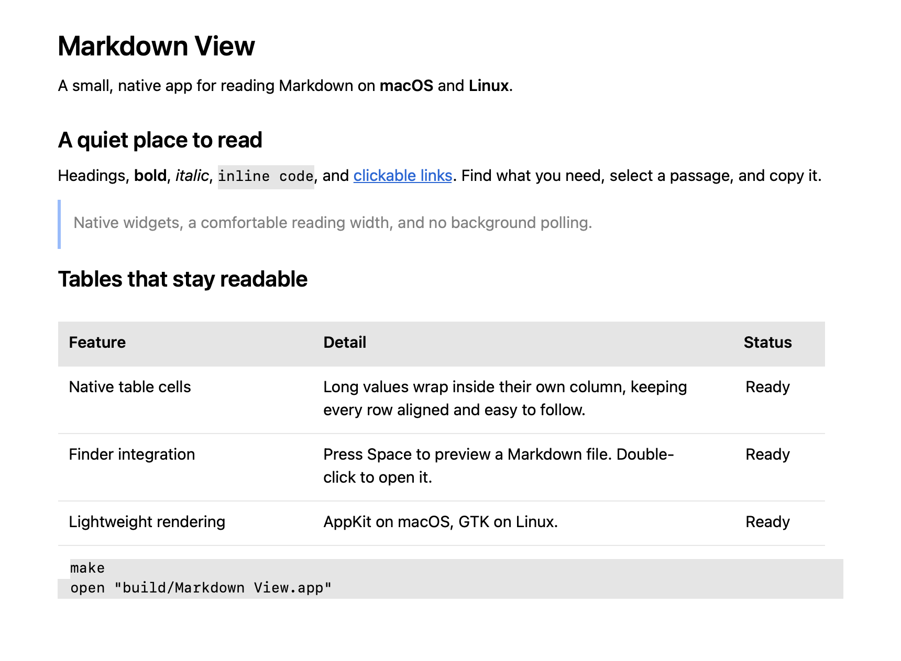

# Markdown View

[](https://github.com/geirfreysson/markdown-view/actions/workflows/build.yml)
[](https://github.com/geirfreysson/markdown-view/releases/latest)

**Open a Markdown file. Read it.**

Markdown View is a small, read-only desktop app for **macOS and Linux**. It uses native text widgets—AppKit on macOS, GTK on Linux—and a compact C parser. There is no browser engine, JavaScript runtime, editor, or background file polling.



*The native macOS document view. Screenshot exported from the app using [this Markdown file](docs/showcase.md).*

## What it does

- Renders headings, bold, italic, strikethrough, quotes, lists, task lists, code, links, tables with wrapping cells, and local images.
- Lets you select and copy text, search within a document, and adjust the text size.
- Opens multiple files in separate windows and resolves relative links against the document's folder.
- On macOS, includes a **Quick Look extension** for Finder's Space-bar preview and an installer that makes it your default Markdown opener.
- Does no recurring work while idle. Reload a changed file when you need to.

## Download and install

Get the files from the [latest release](https://github.com/geirfreysson/markdown-view/releases/latest). Every tagged release is built and tested by [GitHub Actions](https://github.com/geirfreysson/markdown-view/actions). Checksums are included as `SHA256SUMS.txt`.

| Platform | Download | Requirements |
| --- | --- | --- |
| macOS | `.dmg` with installer, or `.zip` with the app | macOS 12+, Apple Silicon or Intel |
| Debian / Ubuntu | `.deb` | x86_64; Ubuntu 22.04+ or compatible |
| Other Linux distributions | `.tar.gz` | x86_64; GTK 3.24+, GLib 2.66+, glibc 2.34+ |

### macOS

1. Download and open the `.dmg`.
2. Run **install.command** inside it. It installs the app in `~/Applications`, registers Quick Look, and makes Markdown View the default opener for Markdown files.
3. Select an `.md` file in Finder and press **Space** to preview it. **Double-click** to open it in Markdown View.

If macOS asks, enable **Markdown Preview** in **System Settings → General → Login Items & Extensions → Quick Look**. The exact settings location varies with the macOS version.

You can also copy the app from the ZIP into Applications and choose **Open With → Markdown View → Change All…** in a Markdown file's Get Info window. To register its Quick Look extension manually:

```sh
pluginkit -a "$HOME/Applications/Markdown View.app/Contents/PlugIns/MarkdownPreview.appex"
pluginkit -e use -i io.github.markdownview.viewer.quicklook
```

The installer changes Markdown associations only; it leaves ordinary text files alone. It saves previous Markdown defaults in `~/Library/Application Support/Markdown View/previous-defaults.json` and backs up an existing installation before replacing it.

**Signing:** `MACOS_SIGNING.txt` on each release states whether that build is Developer ID signed and Apple-notarized. The release workflow signs and notarizes when its Apple secrets are configured; otherwise it produces explicitly labelled ad hoc builds. Those builds may need approval through Finder's Open command or System Settings → Privacy & Security → Open Anyway. Quick Look also needs macOS to accept and enable its extension.

### Linux

For Debian / Ubuntu, install the downloaded package using `apt`, which also installs its GTK dependencies:

```sh
sudo apt install ./markdown-view-0.3.1-linux-amd64.deb
```

The app appears in your desktop's application menu and Markdown files' **Open With** menu. Select it as the default in your file manager if desired.

For the tarball:

```sh
tar -xzf markdown-view-0.3.1-linux-x86_64.tar.gz
./markdown-view/bin/markdown-view README.md
```

Install GTK 3 from your distribution if it is not already present. The Linux app supports Wayland and X11 and follows the desktop theme. The tarball contains an executable and desktop entry; it does not bundle GTK or glibc.

## Keyboard shortcuts

| Action | macOS | Linux |
| --- | --- | --- |
| Open | ⌘O | Ctrl+O |
| Find | ⌘F | Ctrl+F |
| Next / previous match | ⌘G / ⇧⌘G | Ctrl+G / Ctrl+Shift+G |
| Zoom in / out | ⌘= / ⌘− | Ctrl+= / Ctrl+− |
| Reset zoom | ⌘0 | Ctrl+0 |
| Reload | ⌘R | Ctrl+R |
| Close window | ⌘W | Ctrl+W |
| Quit | ⌘Q | Ctrl+Q |

Press Enter in the search box to find the next match. Search ignores case and wraps around. Copy and Select All use the normal platform shortcuts.

## Rendering details

The parser supports CommonMark syntax with GitHub-style tables, strikethrough, task lists, and automatic links. The native renderer supports the features listed above; it does not aim to reproduce a browser's HTML layout.

- Tables have content-based column widths, independently wrapping cells, Markdown column alignment, shaded headers, padding, and subtle row separators. Wide tables scroll horizontally. macOS uses AppKit text tables; Linux uses GTK cells with a searchable text representation. On Linux, drag to select text inside an individual cell; Select All and Copy include the complete table.
- Raw HTML is displayed as text. Code uses a monospace font without syntax highlighting.
- Local images fit within 640 × 480 points/pixels. Remote or missing images appear as linked descriptions, without automatic network requests.
- Quick Look is sandboxed: macOS may prevent it from loading image files next to a document.
- Links to local Markdown files open in the viewer. Web links open in your default browser.
- In-document heading anchors, math, and diagrams are not implemented.
- Files must be UTF-8, optionally with a BOM, and at most 128 MB.

## Performance

The viewer uses one process, cached formatting attributes, and the OS's text layout system. It releases source data after rendering and has no background timers. Quick Look runs in a separate, on-demand macOS extension process.

On the development machine (Apple Silicon, macOS 26.6.2), three consecutive launches of the [sample document](tests/sample.md) measured:

| Measurement | Result |
| --- | --- |
| First document display, from entry into `main()` | 219–241 ms |
| Physical memory footprint at first display | 23–27 MiB |
| Idle CPU in `ps` samples | 0.0% |
| Original arm64 viewer executable | 217 KiB |

These were **warm launches**, measured before adding the Quick Look bundle. They exclude OS process/loader work before `main()` and are not a cold-start guarantee. The universal download includes two architectures and the extension. RSS was about 121 MiB, including resident shared frameworks and fonts; it is a different metric from physical memory footprint. Document length, formatting, and images affect resource use.

macOS loads and renders files off the main thread. Linux renders on the main thread, so unusually large documents can pause its interface while loading. Linux performance has not been benchmarked.

## Build from source

### macOS

Requires Apple's command-line tools (`xcode-select --install`), but not the full Xcode app:

```sh
git clone https://github.com/geirfreysson/markdown-view.git
cd markdown-view
make
open "build/Markdown View.app" --args "$PWD/tests/sample.md"
```

`make install` installs the app and configures Finder integration. For an Intel + Apple Silicon universal build:

```sh
make clean
make ARCH_FLAGS="-arch arm64 -arch x86_64"
make package
```

### Linux

On Debian / Ubuntu:

```sh
sudo apt install build-essential pkg-config libgtk-3-dev xvfb dpkg-dev
git clone https://github.com/geirfreysson/markdown-view.git
cd markdown-view
make
./build/markdown-view tests/sample.md
sudo make install
```

On Fedora, the build dependencies are `gcc make pkgconf-pkg-config gtk3-devel`. `PREFIX` and `DESTDIR` are supported for installation. `make package` builds a tarball and DEB on a Debian-based build machine.

### Tests and benchmarks

```sh
make test                 # Shared renderer
make test-native          # Native UI; also Quick Look controller on macOS
```

Linux's native test uses `xvfb-run`. CI runs both platforms' tests, checks the renderer with AddressSanitizer and UndefinedBehaviorSanitizer, verifies macOS signatures and universal architectures, and packages downloads. Pushing a `v*` tag publishes a release only after both platform jobs succeed.

On macOS:

```sh
./build/markdown-view --benchmark tests/sample.md  # Parse/render time and memory
./build/markdown-view --profile tests/sample.md    # Launch to first document display
./build/markdown-view --screenshot docs/showcase.md # Export document view to build/preview.png
```

## Project structure

`src/render.c` is the shared Markdown-to-text renderer. `src/native.m` supplies AppKit attributed text to both the macOS app and Quick Look extension. `src/linux.c` supplies the GTK interface. `scripts/` contains installation, signing, notarization, and release packaging; `.github/workflows/build.yml` builds, tests, and publishes downloads.

Markdown parsing uses vendored [MD4C 0.5.2](https://github.com/mity/md4c), with its [MIT license](vendor/md4c/LICENSE.md). There are no runtime package downloads or dependency installation steps inside the app.

## Apple signing setup

An existing Developer ID Application certificate and App Store Connect notarization API key can be reused across apps. Configure these repository secrets, matching the names used by Raynard:

| Secret | Value |
| --- | --- |
| `CSC_LINK` | Base64-encoded Developer ID certificate and private key (`.p12`) |
| `CSC_KEY_PASSWORD` | Export password for that `.p12` |
| `APPLE_API_ISSUER` | App Store Connect API issuer ID |
| `APPLE_API_KEY_ID` | API key ID |
| `APPLE_API_KEY_BASE64` | Base64-encoded API private key (`.p8`) |

GitHub repository secrets cannot be read back or automatically inherited from a different repository. Add the original values in repository settings, or use organization secrets with access to both repositories. Tauri updater keys are not used by this app.

On a tagged or manually dispatched build with the secrets configured, CI imports the certificate into a temporary keychain, signs the app and Quick Look extension with the hardened runtime, notarizes and staples the app, packages it, then signs, notarizes, and staples the DMG. The ZIP contains the notarized, stapled app. Failed signing or notarization stops publication.
